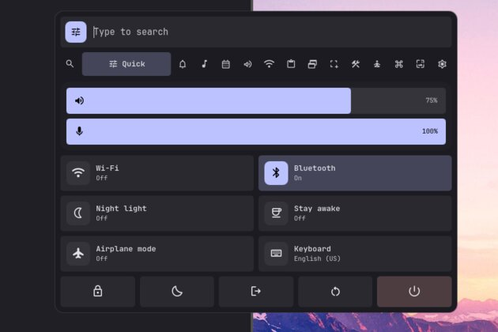
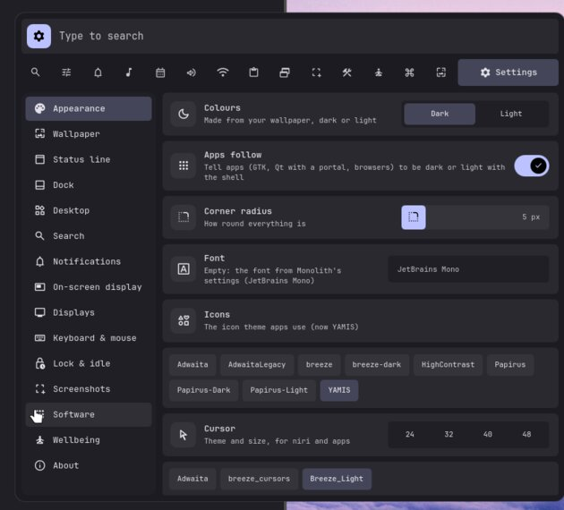

# Monolith

**really good desktop :3**

My Linux desktop (Arch or Gentoo): [niri](https://github.com/YaLTeR/niri) running **Monolith**, my [Quickshell](https://quickshell.org) desktop shell, plus my niri config, keybinds and helper scripts.

---

## Preview

**Quick**: volume, toggles and power, one of the hub's pages



**Settings**, also in the hub



---

## Install

One command, on Arch or an Arch-based distro (CachyOS, EndeavourOS, ...) or on Gentoo, as your normal user:

```sh
curl -fsSL https://raw.githubusercontent.com/apolloKapa/monolith/main/install/get.sh | bash
```

Once it's installed, **`monolith installer`** opens the installer again to update, reinstall or change options. Settings → About → Update does the same, and the bar shows when there's an update.

### What the installer does

It opens a menu (arrow keys or j/k, Enter, q to quit):

| Option | Default | What it is |
|---|---|---|
| Packages overview | | everything it's about to install, and what you already have |
| Apps for the keybinds | ON | what the keybinds/autostart call: librewolf, thunar, mission-center, steam, wooz, awww, swaylock, swappy, grim/slurp, cliphist, playerctl, brightnessctl, fonts, ... |
| niri config | Monolith config | writes the niri config below (your old one is backed up to `~/.config/niri_backup/`); or "keep mine" |
| Login screen | ON | SDDM theme, with options to replace your current display manager and use Wayland for SDDM |
| Wallpapers | 3 random + 1 live | 3 random pictures and 1 live wallpaper / the full pack (184 pictures and 27 live wallpapers, about 1.1 GB) / none, from the [wallpapers](https://github.com/apolloKapa/wallpapers) repo (live ones go into `Wallpapers/Live`; `WALLPAPER_REPO=` to use another) |
| Install / Update / Reinstall | | Update keeps your settings; Reinstall starts them fresh |

Then it:

1. installs the packages, plus the Iosevka Nerd Font:
   - **Arch**: official repos via pacman, AUR via yay/paru (it builds yay if you have neither)
   - **Gentoo**: Portage, all built from source. It enables the `::guru` overlay (niri, Quickshell, matugen, ...) and `::librewolf`, and keeps its Portage settings in `/etc/portage/package.use/monolith`, `package.accept_keywords/monolith` and `zz-monolith-autounmask` files. Those `monolith` files are rewritten on every update, so put your own lines in other files. Installed packages whose USE flags Monolith changes are rebuilt (util-linux gets `caps` for `setpriv`), and LibreWolf is pinned to the LLVM your Rust was built with, so it doesn't drag in a chain of older Rust versions. wooz and wl-gammarelay-rs have no ebuild, so they're built from source into `~/.local`. A fresh install syncs Portage but doesn't run a full `@world` update; run `sudo emerge -avuDN @world` yourself when you like.
2. installs the shell into `~/.local/share/monolith` and links `monolith` into `~/.local/bin` (an older install's classic shell and `monolithd` are replaced)
3. puts the bundled icon packs (YAMIS) into `~/.local/share/icons`, keeping any of the same name you added yourself
4. adds `/etc/pam.d/monolith`, so the lock screen can check your password
5. writes the niri config (old one backed up) and generates the display and workspace setup from the monitors it finds
6. sets up SDDM and wallpapers, if picked (the SDDM theme is off by default when you already use another one)
7. creates `~/.config/monolith/settings.json` from the defaults in `config/monolith/settings.json` (an existing one is kept); the shell reads its dock apps, terminal, font and wallpaper folder from it until you change them in Settings
8. enables PipeWire, NetworkManager, power-profiles-daemon and EasyEffects
9. **starts Monolith right away** if you run it from inside niri (from any other session it waits until you log into niri), so no reboot is needed

**Other shells stay as they are.** Monolith is a separate shell with its own files, and it only runs in niri. If Serpantinum (or anything else) is installed, it isn't stopped, moved or edited, and your Hyprland/Sway/other configs aren't touched. fastfetch always gets Monolith's look; the config that was there before is kept as `~/.config/fastfetch/config.jsonc.pre-monolith`. The installer also makes kitty show it when it opens: fish gets `~/.config/fish/conf.d/monolith-fastfetch.fish`, bash/zsh a marked block at the end of `~/.bashrc`/`~/.zshrc` (skipped if your shell already runs fastfetch; remove it and updates won't add it back).

There's no telemetry in the installer or the shell.

---

## Where to change things

niri reloads its config as soon as you save, so keybind/monitor/layout edits apply right away. The files below are in `~/.config/niri/config/`; the repo copies are in `config/niri/config/` (edit those too if you want the change on every machine).

| What | Where |
|---|---|
| **Keybinds** | `keybinds.kdl` (`Mod+Shift+/` lists them all) |
| **Monitors**: resolution, refresh rate, position, scale, rotation, on/off | `output.kdl` (`niri msg outputs` shows names and modes). Settings → Displays sets on/off, resolution, refresh rate and scale here; `monolith installer` regenerates this file from your current setup |
| **Workspaces** (and which monitor they live on) | `workspaces.kdl` |
| **Keyboard layouts, mouse, touchpad, cursor** | `input.kdl`, or Settings → Devices → Keyboard & mouse / Appearance |
| **Apps that start with niri** | `autostart.kdl` |
| **Gaps, column widths, window borders, animations** | `layout.kdl` |
| **Window rules** (floating, sizes, rounded corners) | `rules.kdl` |
| **Environment variables** | `env.kdl` |
| **The shell**: styles, colours, bar, dock, widgets, lock screen, notifications, sounds, idle, startup apps | Settings (`Mod+S`, with a search box), saved in `~/.config/monolith/next.json`; profiles in `~/.config/monolith/profiles/` |
| **Wallpapers** | `~/Pictures/Wallpapers` (live ones in `Live/`), pick with `Mod+W` |
| **Helper scripts** (focuswin, snap, ...) | `~/.local/bin` (repo: `bin/`) |

After editing a niri file, `niri validate` tells you if something's wrong.

## The shell

**The island** hangs from the top edge of each screen. Collapsed it's the bar: the control center button, search, the clock and weather, workspaces, now playing (or the window title), what's running (a recording, the timer, an update, game mode), tray, system stats, notifications, network, volume and power. Click a part and the island grows into its page, then shrinks back when you close it. Type on any page to search; Tab / Shift+Tab move between pages, Esc closes.

The bar has five styles (Island, Fill, Frame, Solid, Modular), can sit at the top, bottom, left or right, and its modules can be dragged around in Settings → Bar. You pick which screens get it.

### The pages

| Page | What's on it |
|---|---|
| Search | apps (the ones you open most come first), `>` a command in your terminal, `:` emojis, `/` or `~` files, a calculator; an optional grid view and category tabs |
| Control center | **Controls**: volume, mic and brightness, toggle tiles (Wi-Fi, Bluetooth, do not disturb, night light, stay awake, airplane mode, power mode, keyboard layout, record), now playing, lock / suspend / log out / restart / power off. **Overview**: weather, this month, the clipboard, this PC. **Monitor**: CPU, memory, GPU and temperature rings, disks, ping |
| Notifications | history, actions, do not disturb |
| Media | the player, synced lyrics (LRCLIB), a 10-band equaliser (EasyEffects) |
| Calendar | the month, the weather now, by hour and by day |
| Sound | outputs, inputs, each app's volume |
| Network | Wi-Fi (connect, forget, passwords), Ethernet, Bluetooth devices |
| Clipboard | text and image history |
| Windows | every window, switch or close |
| Capture | screenshots and recordings through the capture menu (below), with an optional delay; the focused window; recent screenshots |
| Gaming | game mode (performance power profile, do not disturb, screen kept awake, optionally the island tucked away; it survives a shell restart), CPU and GPU load, temperatures, clock, power and memory with two-minute graphs, a performance overlay, ending a stuck program, LACT and Steam |
| Tools | timer, notes, unit converter |
| Wellbeing | screen time for a day (against the day before, the busiest hour, the daily average), that week's bars and the month as a heatmap; each app's own view (its hours, its week, a daily limit); a week as days × hours; its settings behind the gear (tracking, a daily goal, every limit) |
| Keys | every niri keybind, searchable |
| Wallpaper | a coverflow (or grid) of your pictures and live wallpapers; set one for every screen or just one ("Set on"), star favourites (S) and find them on the Favourites tab. The colours come from the wallpaper (matugen) |
| Settings | everything below, with a search box that jumps straight to a setting |

Small dropdowns also come out of the bar: notifications, sound, the tray's menus, and **the system monitor** (click the stats): two-minute graphs for CPU, GPU, memory, video memory and both temperatures, the GPU's clock and power, and the busiest apps by CPU, memory or video memory, each with a button to end it.

### Settings

| Section | What's in it |
|---|---|
| General | you and the weather (your city or your connection's location), **profiles & backup** (save all settings under a name and switch, e.g. `monolith profile Gaming`; back up to a file and bring it back), updates and about |
| Appearance | 17 styles (Material, Orbit, Liquid glass, Minimalist, Terminal, Brutal, Luxe, Poster, Bubbly, Paper, Arcade, OLED, Mainframe, Sakura, Fjord, Doodle, Shadow) and 96 colour themes, dark or light (apps can follow), font, icons, cursor, wallpaper, the **wallpaper playlist**, blur, opacity, shadows, grain, animation speed, other apps' colours (kitty, GTK, Qt), Fastfetchlings (the terminal greeting: fastfetch presets with live previews) |
| Bar | layout and modules, auto-hide, which screens have the bar and dock |
| Menus & launcher | the launcher, where each menu opens |
| Dock | position, size, auto-hide, magnify, pinned apps |
| Desktop | widgets (arranged in a full-screen editor, with presets) and quick access (a tool strip on a screen edge) |
| Windows | gaps, borders, focus ring, corners, animations (niri's config) |
| Displays | arrange, resolution, refresh rate and scale; night light |
| Devices | keyboard layouts, repeat, mouse and touchpad; microphone and camera |
| Notifications | timeout, style, where they pop up, **what happens while an app is fullscreen** (show on another screen, hold them for one summary afterwards, or show over it), sounds, the on-screen pop-up |
| Lock & idle | what happens when you're away (lock, dim, screens off, sleep, your own commands), and **the lock screen**: the same on every screen or each screen its own, and which screen has the password box |
| Screenshots | folder, file type, the editor, the preview card, which tools the capture menu has, the delay, the text-recognition languages |
| System monitor | what clicking the bar's stats opens, warnings when video memory, memory or a temperature stays too high |
| Software | startup apps, AppImages |

Every setting shows a dot when it's changed from the default, and ↺ puts it back.

### Wallpapers

Pictures and live wallpapers (videos and GIFs) from `~/Pictures/Wallpapers` (live ones in `Wallpapers/Live`). A live wallpaper plays a copy made at each screen's size and goes to sleep on the screen with a fullscreen app (or everywhere in game mode), so it costs about as much as a picture. Each screen can have its own. The **playlist** changes the wallpaper every few minutes (from pictures, live wallpapers or your favourites, shuffled or in order, one per screen if you like) or at times of day you set. `monolith wallpaper next` skips ahead.

### Capture

**The capture menu** (Print): the screens freeze and dim; drag an area (move it, resize it by the corners) or pick a whole screen (F), then:

| Key | |
|---|---|
| Enter | save (and copy) |
| Ctrl+C | copy |
| E | edit |
| P | pin it on screen |
| T | read the text (tesseract) |
| Q | scan a QR code |
| Tab | switch to video and record the area |

After a shot a **preview card** comes up in a corner (edit, copy, pin, open the folder, delete). **The editor** is Monolith's own (pen, highlighter, line, arrow, box, oval, text, numbered steps, pixelate, crop, undo; saved at full size), or Satty / Swappy if you prefer. **Pinned shots** float over your windows: drag to move, scroll to make them see-through, double-click to let go. Which tools the menu shows, the file type (PNG, JPEG, WebP) and copying on save are in Settings → Screenshots.

### Lock screen

The wallpaper blurred, a small island with the date and weather, your widgets (a clock, notifications and what's playing by default) and the password pill with your picture and the sleep / restart / power off buttons (restart and power off are held for a second). Arrange it in the widget editor's Lock screen tab: the widgets **and the password box** can be dragged anywhere. With more than one screen, each screen can have its own lock screen (say the clock on one, the password and news on the other), and the password box can be on every screen or just one; you can type on any screen either way.

### Notifications and sounds

Notifications pop up in the island or stack at a screen corner, can be swiped (or thrown) away, and stay in the list. While a fullscreen app (a game) covers the screen they'd appear on, they go to another screen, or wait and come back as one summary, silently unless you want sound. **Interface sounds** (off by default) come in five packs (Soft, Glass, Pop, Retro, Wood) or your own folder, for clicks, switches, menus, volume steps, workspaces, screenshots, locking and wallpaper changes, each kind on or off.

### Also

The dock (pinned and open apps, right-click menu, a drag-and-drop editor), the on-screen display, desktop widgets (clocks, weather, now playing, lyrics, a visualizer, calendar, system usage, battery, GitHub contributions, notes, a picture and more, in several looks each), quick access on the screen edges (a calculator, a drawing pad, notes, a timer, a converter, usage), idle lock and screens off, a polkit agent, and the AppImages window (`Mod+I`: drop an AppImage on it and it becomes a normal app). Settings shows previews: the screens' arrangement (drag to move), the bar, icon packs, cursors, fonts. The first start shows a short welcome tour.

---

## niri config

Modular config in `~/.config/niri/` (source: `config/niri/`):

| File | Contents |
|---|---|
| `config.kdl` | includes the files below |
| `config/env.kdl` | `prefer-no-csd`, environment variables (qt6ct, Niri session vars) |
| `config/input.kdl` | keyboard (your layout, set by the installer; Alt+Shift switches between layouts), numlock, flat mouse accel, focus follows mouse, Breeze cursor |
| `config/output.kdl` | **generated**: each monitor's current mode, position, scale, rotation; disabled monitors set to `off` |
| `config/workspaces.kdl` | **generated**: workspaces 1 to 10 on the main monitor, `d2-1` to `d2-10` on a second one, each pinned to its monitor so they return there after it was off |
| `config/layout.kdl` | 10px gaps, column presets, 2px white/grey borders, no focus ring, no hot corners, snappy spring animations |
| `config/autostart.kdl` | only what Monolith needs: clipboard history + `monolith start --login` (the shell, and your startup apps from Settings → Software). Add your own apps here; when the installer replaces the niri config it keeps the startup apps you had |
| `config/keybinds.kdl` | the keybinds below |
| `config/rules.kdl` | rounded window corners, Steam toasts as notifications |

The installer reads displays from the running niri. If you install from a TTY, nothing is pinned and niri picks each monitor's preferred mode; run `monolith installer` from inside niri later to pin the layout. Settings → Displays can also change resolution, refresh rate and scale, and saves them.

## Running on Hyprland

The shell also runs on [Hyprland](https://hyprland.org). It notices by itself (Hyprland sets `HYPRLAND_INSTANCE_SIGNATURE`) and reads workspaces, windows, the focused screen and the keyboard layout from Quickshell's Hyprland module instead of niri. Window switching and closing, workspaces, layout switching, turning screens off when idle and logging out use Hyprland's dispatchers.

The installer's first menu line, **Desktop**, picks niri or Hyprland (it starts on Hyprland when you run it from a Hyprland session). With Hyprland it doesn't install or set up niri; instead Monolith becomes Hyprland's shell. On niri you can still do that later with `monolith hyprland on`. Either way it:

- backs up `~/.config/hypr` to `~/.config/hypr.before-monolith`
- turns off (comments out, marked `monolith-off:`) only the lines that start Serpantinum or call it; Serpantinum itself stays installed
- adds Monolith's start line and keys in a file of its own, `~/.config/hypr/monolith.lua` (for a Lua config, `hyprland.lua`) or `monolith.conf` (for `hyprland.conf`), included at the end of your config. The keys are the ones Serpantinum used: Super+D launcher, Super+C clipboard, Super+B control center, Super+M media, Super+W wallpapers, Super+S calendar, Super+N network, Super+V sound, Super+H keybinds, Super+A notifications, Super+L lock, Print screenshot, Super+1…0 workspaces

With Hyprland chosen, the menu's **Hyprland keys** line picks the keys: **keep mine** (your config's keys stay, and Serpantinum's are pointed at Monolith) or **Monolith's**: the same key layout as Monolith's niri setup, made from its niri keymap (your other keys are turned off; mouse drags and gestures stay).

Log in to Hyprland again and Monolith starts. `monolith hyprland off` puts the backed-up config back, so Serpantinum starts there again.

What stays niri-only: the Displays, Keyboard & mouse and Windows settings pages, the cursor theme and the screenshot folder setting change niri's config, so on Hyprland they show a note and you set those in `hyprland.conf`. The window switcher's overview button uses the [hyprexpo](https://github.com/hyprwm/hyprland-plugins) plugin when it's loaded.

## Keybinds

`Mod` is the Super/Windows key. `Mod+Shift+/` shows niri's own list.

**Apps**

| Key | Action |
|---|---|
| `Mod+C` | terminal (kitty) |
| `Mod+B` | browser (LibreWolf) |
| `Mod+E` | files (Thunar) |
| `Mod+Escape` | Mission Center |
| `Mod+Z` / `Mod+Space` | the hub: search apps, files (`/`, `~`), emojis (`:`), commands (`>`) |
| `Mod+Tab` | windows (switcher and overview) |
| `Mod+Alt+V` | clipboard history |
| `Mod+Ctrl+scroll` | zoom (wooz): up opens it, scroll inside to zoom, down closes it (`Mod+Ctrl+Z` opens it too) |
| `Mod+I` | the AppImages window |

**Monolith**

| Key | Action |
|---|---|
| `Mod+D` | Quick (volume, toggles, power) |
| `Mod+S` / `Mod+Alt+H` | Settings |
| `Mod+N` | Network |
| `Mod+V` | Sound |
| `Mod+A` | bar auto-hide |
| `Mod+Alt+C` | Clipboard |
| `Mod+X` / `Mod+Alt+M` | Media |
| `Mod+P` | Keys (every keybind) |
| `Mod+W` / `Mod+Alt+W` | Wallpaper |
| `Mod+L` / `Mod+Alt+L` | lock |
| `Mod+Ctrl+Alt+L` | swaylock |
| `Mod+H` | restart the shell |
| `Mod+G` | Wellbeing (screen time) |

**Windows**

| Key | Action |
|---|---|
| `Mod+Q` | close |
| `Mod+Arrows` | focus column left/right, window up/down |
| `Mod+J` / `K` | focus window down / up (`Mod+Left` focuses the column to the left) |
| `Mod+Shift+Arrows` | focus monitor |
| `Mod+Ctrl+Arrows` | move column left/right, window up/down |
| `Mod+Ctrl+H/J/K/L` | move column / window |
| `Mod+R` | float / tile the focused window |
| `Mod+T` | maximize (fills the screen, keeps border and gaps; press again to restore) |
| `Mod+F` / `Mod+Shift+F` | fullscreen / maximize column |
| `Mod+Ctrl+F` | expand column to available width |
| `Mod+Ctrl+C` | center visible columns |
| `Mod+-` / `Mod+=` | column width -/+ 10% |
| `Mod+Shift+-` / `Mod+Shift+=` | window height -/+ 10% |
| `Mod+Shift+R` / `Mod+Ctrl+Shift+R` / `Mod+Ctrl+R` | preset widths back / preset heights / reset height |
| `Mod+[` / `Mod+]` | consume or expel window left / right |
| `Mod+,` / `Mod+.` | consume into column / expel from column |
| `Mod+Shift+W` | tabbed column |
| `Mod+Shift+V` | switch focus floating ↔ tiling |
| `Mod+Home` / `Mod+End` | first / last column (`+Ctrl` moves it) |

**Workspaces and monitors**

| Key | Action |
|---|---|
| `Mod+1` to `Mod+0` | workspace 1 to 10 |
| `Mod+Ctrl+1-0` / `Mod+Shift+1-0` | move column to workspace |
| `Mod+Page Up/Down`, `Mod+U` | workspace up / down (`+Ctrl` moves the column, `Mod+Ctrl+I` up) |
| `Mod+Scroll` | workspace up / down (`+Ctrl` moves the column), sideways scroll = columns |
| `Mod+O` | overview |
| `Mod+Alt+Arrows`, `Mod+Shift+H/J/K/L` | focus monitor |
| `Mod+Shift+Ctrl+Arrows` / `H/J/K/L` | move column to monitor |
| `Mod+Shift+P` | turn monitors off |

**System**

| Key | Action |
|---|---|
| `Print` / `Mod+Shift+S` | screenshot: pick a region (or window) |
| `Shift+Print` | screenshot a region and open it in the editor |
| `Ctrl+Print` / `Mod+Print` | screenshot the whole screen |
| `Alt+Print` | whole screen, then the editor |
| media / volume / mic / brightness keys | work as labelled (also on the lock screen) |
| `Mod+M`, `Mod+Shift+E`, `Ctrl+Alt+Delete` | quit niri |

## Commands

| Command | What it does |
|---|---|
| `monolith installer` | open the installer (update, reinstall, change options) |
| `monolith installer --update` | update without the menu (what Settings → About → Update runs) |
| `monolith start` / `stop` / `restart` | run / stop / restart the shell |
| `monolith msg toggle <page>` | open/close a page: `launcher`, `system` (control center), `settings`, `network`, `volume`, `music`, `clipboard`, `wallpaper`, `calendar`, `switcher`, `cheatsheet`, `gaming`, `tools`, `wellbeing`, `capture`, `emoji`, `autohide`, … |
| `monolith settings [section]` | open Settings (e.g. `monolith settings display`) |
| `monolith search <text>` | open Search with text typed (`:smile`, `~/Documents`) |
| `monolith lock` | lock the screen |
| `monolith screenshot [--full] [--edit]` | the capture menu (`--full` alone: the whole screen at once; `--edit`: Enter opens the editor) |
| `monolith capture-in <seconds> [screen]` | the capture menu after a countdown |
| `monolith edit-image <file>` / `pin-image <file>` | a picture in the screenshot editor / pinned over the windows |
| `monolith record-menu` | the capture menu, set to video |
| `monolith wallpaper [next]` | the next wallpaper (the playlist's, else a random picture) |
| `monolith profile [name]` | switch to a saved profile (no name: list them) |
| `monolith widgets [lock]` / `dock` | arrange the desktop's (or lock screen's) widgets / edit the dock |
| `monolith appimages` / `welcome` / `zoom in\|out` | the AppImages window / the welcome tour / zoom |
| `monolith timer <minutes>` / `record [region]` | start a timer / start or stop recording |
| `monolith set <setting> <json>` / `get <setting>` | change or read a setting, e.g. `monolith set bar.position '"bottom"'` |
| `monolith migrate` | move an older niri config (the classic shell's `monolithd`) over to this shell |

Helper scripts in `bin/` (installed to `~/.local/bin`):

- `focuswin`, `swapwin`, `snap`, `tilehalf`, `maxtoggle`: desktop-style window focus, swapping, half-screen snapping and maximizing for floating windows (not bound by default since Monolith uses normal niri tiling; bind them in `keybinds.kdl` if you want them)

## Repo layout

| Path | Contents |
|---|---|
| `install/` | the installer: `get.sh` (one-command), `install.sh`, `modules/`, `strings.json` |
| `install.sh` | runs `install/install.sh` from a clone |
| `monolith/bin/monolith` | the command |
| `monolith/shell/` | the shell: `core/` (services), `island/` (the bar), `hub/` (the pages; `hub/settings/` the Settings sections), `status/` (popups, dropdowns, quick access), `dock/`, `wall/` (wallpaper, widgets, picker, editor), `lock/`, `capture/` (capture menu, editor, pins), `ui/` (shared parts), `sounds/`, `themes/`, `scripts/` |
| `monolith/SPEC.md` | the design and the feature list |
| `monolith/dev/nested.sh` | runs the shell in a nested niri window, for trying changes |
| `config/niri/` | the niri config |
| `sddm/` | the SDDM login theme |
| `config/monolith/settings.json` | default settings |
| `bin/` | helper scripts |
| `monolith/tools/` | generators: the interface sounds (`make_sounds.py`), the emoji list (`make_emoji.py`) |
| `docs/media/` | the previews in this README |

Installed files: the shell in `~/.local/share/monolith`; settings in `~/.config/monolith` (`next.json`); state in `~/.local/state/monolith`.

## Updating the repo

**Publishing a Monolith update** (shell or installer changes):

1. edit the files under `monolith/` or `install/`
2. bump the version in `monolith/version.txt`
3. commit and push to `main` (and `next-shell`, which older installs still follow; each machine's branch is in `~/.local/share/monolith/install/source.env`)

Every machine checks every few hours. When GitHub has a newer commit, the bar says so and Settings → About shows it; **Update** runs `monolith installer --update`, which refreshes the shell, installs any new dependencies, keeps your settings, niri config, login screen and wallpapers, and restarts the shell.

If you install from a private fork, the update check goes through the GitHub CLI (`gh auth login` once per machine).

**Your own config changes**: niri files live in `config/niri/config/` (don't commit `output.kdl` / `workspaces.kdl`, they're generated per machine); helper scripts in `bin/`.

## Troubleshooting

- **Nothing on screen:** run `quickshell -p ~/.local/share/monolith/shell/shell.qml` in a terminal to see errors.
- **No weather:** set your city in Settings → General → You & weather (or use your connection's location there).
- **A setting you can't find:** the search box at the top of Settings.
- **Wrong monitor layout:** Settings → Displays, or run `monolith installer` from inside niri, or edit `~/.config/niri/config/output.kdl`, then `niri validate`.
- **Lock screen won't accept your password:** check `/etc/pam.d/monolith` exists (the installer adds it). If you're ever stuck, switch to a TTY (Ctrl+Alt+F3), log in, and run `monolith stop`.
- **Stuck in game mode's power profile after a crash:** turn game mode on and off again (it remembers what to put back), or `powerprofilesctl set balanced`.

## Licence

Copyright (C) 2026 apolloKapa

**The shell** (`monolith/`) is written from scratch and licensed under the [GNU GPL-3.0](monolith/LICENSE).

Monolith's earlier versions were a fork of [Serpantinum](https://github.com/ilyamiro/serpantinum) by [@ilyamiro](https://github.com/ilyamiro) (GNU AGPL-3.0). That shell is gone; the installer and the rest of this repo grew out of that version and stay under the [GNU AGPL-3.0](LICENSE).

The YAMIS icon pack (`config/icons/YAMIS`, "yet another monochrome icon set") is by [Dirn](https://bitbucket.org/dirn-typo/yet-another-monochrome-icon-set), licensed under the GNU GPL-3.0, and ships unchanged.

The emoji search's short names and tags (`:sob:`, `:thumbsup:`) come from GitHub's [gemoji](https://github.com/github/gemoji) (MIT licence); the emoji list itself is generated from Unicode's `emoji-test.txt` (`tools/make_emoji.py`).

The login screen theme is based on [Qylock](https://github.com/Darkkal44/qylock) by Darkkal44, licensed under the GNU GPL-3.0.
